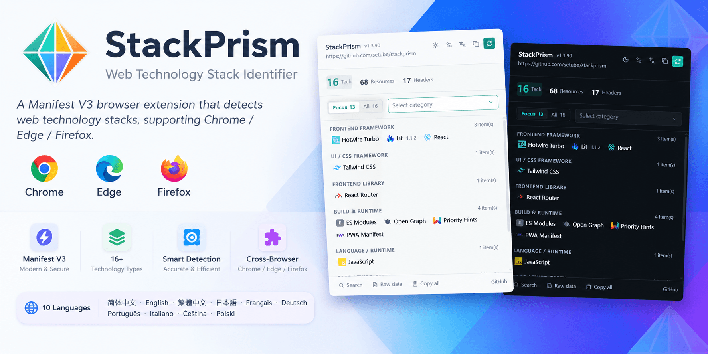

<div align="center">



# StackPrism — Web-Tech-Stack-Detektor

> Sammelt Hinweise aus 6 Dimensionen — Laufzeit-Globals, DOM, Ressourcen-URLs, Antwort-Header, dynamisches Laden und JS-Urheberrechtskommentare — um die Technologien zu identifizieren und zu kategorisieren, die eine Website antreiben.

[简体中文](README.cn.md) · [English](../README.md) · [繁體中文](README.zh-Hant.md) · [日本語](README.ja.md) · [Français](README.fr.md) · **Deutsch** · [Português](README.pt.md) · [Italiano](README.it.md) · [Čeština](README.cs.md) · [Polski](README.pl.md)

[Einführung](#einführung) • [Funktionen](#funktionen) • [Regelsystem](#regelsystem) • [Einschränkungen](#einschränkungen) • [Mitwirken](#mitwirken) • [Sponsoren](SPONSORS.md) • [Star-Verlauf](#star-verlauf) • [Lizenz](#lizenz)

[](https://chromewebstore.google.com/detail/stackprism/cagpdifljieeiajlhlcboelglkalofak)
[](https://microsoftedge.microsoft.com/addons/detail/stackprism/ojgmhlogaoiegdonnlnibeoikbleccno)
[](https://addons.mozilla.org/firefox/addon/stackprism/)
[](https://creativecommons.org/licenses/by-nc-sa/4.0/)
[](https://developer.chrome.com/docs/extensions/develop/migrate/what-is-mv3)
[](#installation)
[](https://github.com/setube/stackprism/issues)

</div>

## Einführung

StackPrism ist eine **Manifest V3** Browsererweiterung für Chrome, Edge und Firefox, die den Tech-Stack einer beliebigen Webseite identifiziert.

Im Gegensatz zu den meisten ähnlichen Tools, die nur HTML-Ressourcen-URLs scannen, führt StackPrism 4 unabhängige Erkennungskanäle parallel aus:

- **Statischer Scan** — beim Seitenaufruf scannt ein injiziertes Skript das DOM, Globals, CSS-Klassennamen, CSS-Variablen und `<meta>`-Tags
- **Beobachtung von Antwort-Headern** — ein Service Worker lauscht auf `webRequest.onHeadersReceived` und erfasst Antwort-Header und HTTP-Version für das Hauptdokument, XHR-Anfragen und iFrames
- **Überwachung dynamischer Ressourcen** — ein Content-Skript nutzt `PerformanceObserver` + `MutationObserver`, um nach Benutzerinteraktion geladene Skripte, Styles, iFrames und Feeds anzusammeln
- **Scan von JS-Urheberrechtskommentaren** — der Hintergrund lädt asynchron die ersten paar hundert Bytes der Hauptpakete, um Drittanbieter-Abhängigkeiten in `index/main/vendor`-Chunks anhand ihrer Urheberrechts-Header zu identifizieren

Ergebnisse aus allen 4 Kanälen werden zusammengeführt und dedupliziert, in 50+ Kategorien gruppiert, mit aktiver Unterdrückung von **gefälschten Headern, selbstreferenziellen Erkennungen und unscharfen Falsch-Positiven**.

### Technische Highlights

- **MV3-Service-Worker-Architektur** — kein persistenter Hintergrundprozess; ereignisgesteuert, geringer Speicherverbrauch
- **Regeln als Daten** — 50+ JSON-Regel-Dateien (`public/rules/`) werden zentral gepflegt; zum Build-Zeitpunkt injiziert ein Vorkompiler `__hints` (die 3 längsten wörtlichen Segmente) und `__keywordCombined` (zusammengeführte Regex) in jede Blattregel, sodass die Laufzeit nur Kandidaten-Übereinstimmungen auswertet

### Erkennungsabdeckung

| Dimension     | Kategorie-Beispiele                                                            |
| ------------- | ------------------------------------------------------------------------------ |
| Frontend      | Frontend-Frameworks / UI-Frameworks / Frontend-Bibliotheken / Build & Laufzeit |
| Backend       | Webserver / Backend-Frameworks / CDN & Hosting / Sprachen                      |
| Inhalte       | CMS / Themes & Templates / E-Commerce / RSS                                    |
| Drittanbieter | SaaS / APM / KI-Modelle / Social Login / Zahlungen                             |
| Marketing     | Werbung / Marketing / Analytics / Tag-Manager                                  |
| Sicherheit    | WAF / HTTPS / HTTP/2 / HTTP/3 / CSP / Cookie-Zustimmung                        |

### UI-Sprachen

Das Popup und die Einstellungsseite sind in 9 Sprachen verfügbar, automatisch erkannt anhand der Browser-Sprache:

🇨🇳 简体中文 · 🇹🇼 繁體中文 · 🇯🇵 日本語 · 🇫🇷 Français · 🇩🇪 Deutsch · 🇧🇷 Português · 🇮🇹 Italiano · 🇨🇿 Čeština · 🇵🇱 Polski

Die Sprache kann auch manuell über den 🌐-Button im Popup-Header umgestellt werden.

## Installation

**Aus dem Quellcode laden** (Entwicklermodus):

```bash
git clone https://github.com/setube/stackprism.git
cd stackprism
bun install
bun run build            # Chrome / Edge
bun run build:firefox    # Firefox
```

**Chrome / Edge:**

1. `chrome://extensions` oder `edge://extensions` öffnen
2. "Entwicklermodus" oben rechts aktivieren
3. "Entpackte Erweiterung laden" klicken und das `dist/`-Verzeichnis auswählen
4. Eine beliebige Webseite besuchen — das Erweiterungs-Icon zeigt die Erkennungsanzahl

**Firefox:**

1. `about:debugging#/runtime/this-firefox` öffnen
2. "Temporäres Add-on laden" klicken und `dist-firefox/manifest.json` auswählen
3. Oder `bun run build:firefox` ausführen und die `.xpi`-Datei in `release/` doppelklicken

### Entwicklung

```bash
bun run dev           # Entwicklungsmodus + HMR
bun run typecheck     # vue-tsc Typprüfung
bun run lint          # ESLint
bun run build         # Produktions-Build (inkl. Regel-Vorkompilierung)
bun run build:firefox # Firefox-Build + .xpi-Paketierung
bun run docs:dev      # VitePress Docs-Vorschau
```

## Regelsystem

Die Erkennung von StackPrism ist datengesteuert — fast alle Änderungen erfordern nur die Bearbeitung der JSON-Regel-Dateien, ohne Code zu berühren.

- **Index** — [public/rules/index.json](public/rules/index.json) listet alle zu ladenden Regel-Dateien auf
- **Seitenregeln** — `public/rules/page/*.json` behandeln Seitenquellcode, DOM, Ressourcen-URLs und dynamische Ressourcen
- **Header-Regeln** — `public/rules/headers/*.json` behandeln Server-Antwort-Header und Cookies
- **Selbst-Unterdrückung** — [public/rules/self-host-suppress.json](public/rules/self-host-suppress.json) überspringt gleichnamige Erkennungen beim Besuch einer bekannten Tech-Site
- **Tech-Links** — [public/tech-links.json](public/tech-links.json) ordnet Tech-Namen ihrer offiziellen URL zu, sodass Ergebnisse anklickbar sind
- **Build-Zeit-Vorfilter** — `precompileRulesPlugin` in [vite.config.ts](vite.config.ts) injiziert `__hints` und `__keywordCombined` in jede Blattregel zur Build-Zeit; die Laufzeit `rule-matcher.ts` nutzt sie als Kandidaten-Filter

Regelschema:

```jsonc
{
  "name": "Meine Technologie",
  "category": "Frontend Framework", // eine von 50+ Kategorien
  "patterns": ["regex-oder-schlüsselwort"],
  "matchType": "regex", // oder "keyword"
  "matchIn": ["html", "resources", "url", "headers", "dynamic"],
  "confidence": "高", // 高 / 中 / 低  (hoch / mittel / niedrig)
  "kind": "description",
  "selectors": ["CSS-Selektor"],
  "globals": ["window-Global-Name"],
  "classPrefixes": ["Klassen-Präfix"]
}
```

### Richtlinien für Regelqualität

- Bevorzuge **aussagekräftige Nachweise**: Antwort-Header, eindeutige Ressourcen-URLs, `<meta name="generator">`, `window.<global>`, eindeutige CSS-Selektoren, Urheberrechtskommentare, offizielle SDK-Paketnamen
- Vermeide kurze oder breite Schlüsselwörter (`spring`, `phoenix`, `column`, `container` — diese treffen auf Erwähnungen von Konkurrenten, Bootstrap/Tailwind-Utility-Klassen und allgemeinen Text)
- Bevorzuge engere `matchIn`-Bereiche — nutze `resources` / `url` / `headers` statt des bloßen `html`, um Falsch-Positive aus Seitentext zu reduzieren

## Einschränkungen

- **Backend-Erkennung ist nicht erschöpfend** — viele Sites verbergen `Server`- / `X-Powered-By`-Header; Backend-Ergebnisse werden als „Hinweise + Konfidenz" angezeigt
- **Gefälschte Header** — die Erweiterung erkennt aktiv Szenarien, in denen ≥4 verschiedene Identitäts-Header koexistieren (was auf eine Honeypot- oder gefälschte Antwort hinweist), und stuft diese Kategorien auf niedrige Konfidenz mit Warnung herab. Einzeln gefälschte Header können nicht erkannt werden, daher sind die Hinweise im Zusammenhang mit anderen Signalen zu nutzen
- **Beim ersten Installieren ist ein Neuladen erforderlich** — der Service Worker muss die Hauptdokument-Antwort-Header beobachten, was nur bei einem frischen Seitenaufruf funktioniert
- **Quellsuche ist ein DOM-Schnappschuss** — basiert auf dem aktuellen `outerHTML` der Seite, nicht dem ursprünglich vom Server zurückgegebenen HTML
- **Chrome-System-Seiten / Store-Seiten / interne Seiten** blockieren generell die Content-Skript-Injektion
- **Dynamische Überwachung sammelt asynchron** — das Content-Skript sammelt nach Benutzerinteraktion geladene Ressourcen; das erneute Öffnen des Popups zeigt das zusammengeführte Ergebnis

## Mitwirken

StackPrism enthält 2000+ Erkennungsregeln in 50+ Kategorien, aber das Frontend-Ökosystem entwickelt sich schnell. **Neue Frameworks, neue SaaS-Tools, Falsch-Positive und übersehene Erkennungen** sind herzlich willkommen:

- **Bug / Falsch-Positiv / Übersehene Erkennung** — [Issues](https://github.com/setube/stackprism/issues) — der „Ungenaue Erkennung melden"-Button im Popup füllt die Issue-Vorlage automatisch aus
- **Regelbeiträge** — klicke auf „Regelbeitrag einreichen" in den Einstellungen oder sende direkt einen PR an [`public/rules/`](public/rules/)
- **Diskussion und Vorschläge** — [Discussions](https://github.com/setube/stackprism/discussions)

Vor dem Einreichen von Code bitte `bun run typecheck && bun run lint && bun run build` ausführen und sicherstellen, dass alle drei Befehle erfolgreich sind.

## Star-Verlauf

Falls dies nützlich ist, hilft ein ⭐ anderen dabei, das Projekt zu finden.

<a href="https://www.star-history.com/?repos=setube%2Fstackprism&type=timeline&logscale=&releases=&legend=bottom-right">
 <picture>
   <source media="(prefers-color-scheme: dark)" srcset="https://api.star-history.com/chart?repos=setube/stackprism&type=timeline&theme=dark&logscale&legend=bottom-right" />
   <source media="(prefers-color-scheme: light)" srcset="https://api.star-history.com/chart?repos=setube/stackprism&type=timeline&logscale&legend=bottom-right" />
   
 </picture>
</a>

## Lizenz

[CC BY-NC-SA 4.0](https://creativecommons.org/licenses/by-nc-sa/4.0/) — nicht-kommerzielle Nutzung, Namensnennung erforderlich, Weitergabe unter gleichen Bedingungen.
